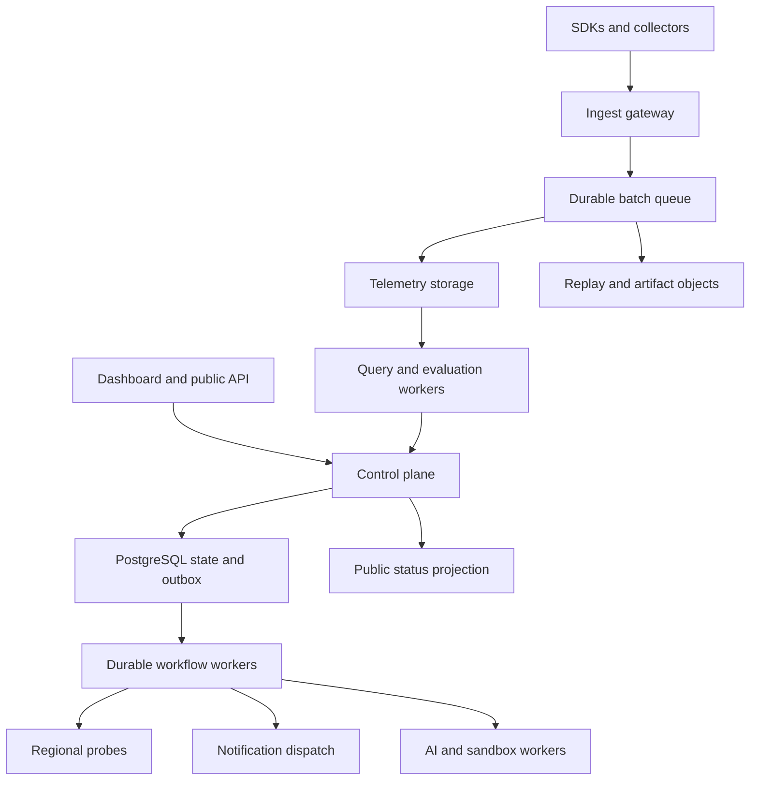

# Target architecture and implementation backlog

This is a proposed architecture for this repository, not a description of Better Stack's internal systems. Read the [module specifications](module-specifications.md) and [finding register](evidence-and-gaps.md) alongside it.

## Architecture

Retain a modular control plane and independently scalable workers. Introduce service boundaries because of distinct workloads and failure isolation, rather than creating a microservice for every page.

PostgreSQL owns memberships, configurations, incidents, alert identities, delivery intents/receipts, workflow references and billing/usage ledgers. Telemetry storage owns analytical events and distributions. Object storage owns bounded replay chunks, screenshots, source maps and immutable evidence artifacts. Query results never become the source of truth for acknowledgement or delivery state.

The incident path is: normalized event receipt → dedup/generation decision → incident mutation + timeline + outbox in one transaction → escalation/notification consumer. Recovery uses the same path with explicit generation checks. The telemetry path acknowledges its defined durable receipt boundary before asynchronous indexing; it publishes query watermarks so delayed indexing is visible.

## Technology decisions

| Concern | Recommendation | Why / tradeoff |
|---|---|---|
| Web | Keep Next.js and existing query/form conventions | Much UI and contract work is reusable |
| Control API | Keep NestJS modules and Zod shared contracts | Transactional consistency is simpler in one control plane |
| Control DB | Managed PostgreSQL with backups and recovery drills | Fits incident commands, tenancy, dedup and outbox constraints |
| Timers/workflows | Keep Temporal for long-lived incident/escalation/AI workflows; explicit SQL leases for high-frequency jobs | Do not create unbounded histories or two competing scheduler owners |
| Initial job admission | PostgreSQL inbox/outbox with leased workers | Fewer systems while volume is modest; bounded capacity required |
| Large ingest queue | Evaluate Kafka-compatible log against managed queue service using ordering/replay/throughput needs | Introduce after measured demand; a queue is not free reliability |
| Logs/traces | Benchmark ClickHouse behind query/ingest interfaces | Columnar scans suit telemetry; requires schema, merge and operational expertise |
| Metrics | Prefer maintained Prometheus-compatible storage/query engine for production semantics; evaluate unified ClickHouse metrics separately | Avoid hand-writing reset/histogram/PromQL semantics; extra store costs complexity |
| Collector | Standard OpenTelemetry Collector distribution, plus versioned product configuration | Existing ecosystem and protocol conformance; custom parsers remain explicit adapters |
| Replay | Evaluate maintained recording library such as rrweb against privacy/fidelity fixtures | Replacing periodic HTML capture is valuable, but compatibility and licensing must be checked before selection |
| Artifacts | S3-compatible storage, lifecycle policies, scoped signed access | Avoid large HTML/maps/screenshots in transactional DB |
| AI | Existing Python worker and model gateway | Preserve evidence, evaluation and sandbox work |
| Notifications | Provider adapters behind one delivery ledger | Can change vendor without redefining escalation semantics |
| Hosting | Managed containers first; multiple failure zones for durable services | Existing managed-container direction fits current maturity; Kubernetes only if operational need justifies it |
| eBPF | Integrate a maintained collector after compatibility review | Requires separate kernel/TLS/overhead validation; do not build a tracer from scratch |

ClickHouse, Prometheus and Temporal are recommendations, not measured winners for this workload. Replay library, ingest queue vendor, messaging providers and enterprise identity vendor remain implementation selection decisions. Before adding each dependency, verify current docs/license/security support and run the bounded proof described below. Do not introduce all optional infrastructure at once.

## Domain ownership and durable records

| Domain | Principal records / constraints |
|---|---|
| Identity | organization, workspace, membership, service identity, scoped token, invitation, audit event |
| Monitoring | monitor, versioned config, probe region, check job/lease, result, transition; unique monitor/run/region |
| Heartbeats | definition, execution, receipt, deadline version; unique definition/execution/signal |
| Alerts | source, normalized event, parser version, alert generation, route version; unique source/event ID |
| Incidents | incident response state/version, alert membership, timeline, acknowledgement, recurrence |
| On-call | schedule/layer/version, timezone rule, participant history, override and coverage projection |
| Escalation | policy version, run, step, branch decision, incident fence, recipient resolution |
| Delivery | notification intent, recipient, attempt, provider receipt, callback event, dead letter |
| Status | page, component, monitor link, public report/update, maintenance, subscription, fanout item |
| Telemetry | source/token, batch receipt, sink checkpoint, schema/rule version, query watermark |
| Errors | project, event ID, grouping version, group, occurrence, release, artifact/sourcemap reference |
| RUM | application, settings version, session, dedup event, batch/chunk receipt, replay manifest, funnel definition |
| AI | conversation, run, evidence set, remediation artifact, approval digest, execution and verification |

Use composite workspace/resource constraints where practical to prevent cross-tenant links at the DB layer. SQL access must remain tenant-scoped even for background operations. Enforce unique event/run/attempt keys in storage, not only application checks. No cross-store transaction is assumed: publish durable intent and reconcile sink checkpoints instead.

## Reliability and operational rules

1. Commit state and the event that announces it atomically. Dispatch network work after commit.
2. Every leased job has owner, expiry, attempt, fencing token and terminal/retry reason. A stale worker cannot overwrite newer state.
3. A provider timeout is ambiguous until reconciled. Exactly-once external delivery cannot be guaranteed without provider cooperation.
4. Acknowledgement fences future attempts; already accepted messages may arrive. Explain this honestly in UI/history.
5. Use isolated task queues/concurrency limits for paging, probes, ingest, queries and AI. AI exhaustion cannot starve paging.
6. All workers expose last-success time, queue lag, lease age, retry/dead-letter count and config version. Separate liveness, readiness and degraded capability.
7. Tenant admission limits apply before expensive decode/query work. Track decompressed sizes, not just network bytes.
8. Backups include control DB, artifact references and workflow recovery configuration. Restore drills verify pending incidents and deliveries, not merely row counts.
9. Public status serving should remain available when the main dashboard or analytical database fails. Publish a bounded projection with explicit freshness.
10. Never keep credentials or private captured payloads in research documents. Diagnostic artifacts use scoped retention and redaction.

## Initial planning envelope

These are **provisional sizing targets**, not observed performance or commercial guarantees: 100 workspaces, 10,000 monitors at a 60-second interval, three regional observations per scheduled check, 1,000 telemetry events/second sustained and 10,000/second short burst, 30-day searchable telemetry, 7-day replay retention. Revisit before implementation using actual expected customers and budget.

10,000 / 60 × 3 = approximately 500 probe executions/second before confirmation retries. Browser transactions need their own budget and concurrency class. At 1,000 events/second and 1 kB/event, raw input is about 86.4 GB/day or 2.59 TB per 30 days, before compression, indexes, replication and object overhead. This is why PostgreSQL-only event storage needs a measured migration point.

Proposed pilot objectives: p99 scheduled-probe start delay below 10 seconds; incident commit to first provider submission p99 below 30 seconds under the agreed load; query visibility p95 below 15 seconds; zero acknowledged durable incident-transition loss in fault tests. Customer detection delay additionally includes check interval, timeout, confirmation and regional policy. Provider submission is not human receipt. Set RPO/RTO with the actual hosting design; a replicated DB does not automatically prove zero data loss.

Benchmark three scenarios: normal mixed tenants, one hot tenant plus normal traffic, and dependency outage/recovery. Measure CPU/memory, DB locks, queue depth, p95/p99 latency, rejected/lost/duplicate counts and cost per accepted GB/check. Promotion thresholds must be recorded before running a benchmark. No exact vendor bill is asserted without current region/retention/provider pricing and measured compression.

## Implementation work packages

Each row is a reviewable work package; split it further during coding. Owners are functional roles, not assigned people. Estimates are engineering effort ranges for planning and may overlap; they are not a delivery promise.

| ID / phase | Work and likely repository area | Depends on | Acceptance / owner |
|---|---|---|---|
| F01 foundation | Add response lifecycle beside existing incident status; contracts, DB enums/tables, lifecycle services | None | Existing AI reads remain compatible; human response works with AI off / API |
| F02 foundation | Typed mail outcomes and transport configuration readiness | None | SMTP/Resend rejection never records sent / API |
| F03 foundation | Delivery ledger, retry and receipt reconciliation; notification modules | F02 | Timeout/429/bounce/duplicate callback fixtures / API |
| F04 foundation | Atomic monitor result/state/outbox; monitor service and DB | None | Crash after each write cannot lose transition / API |
| F05 foundation | Probe job leases, run IDs, stale-result fences | F04 | Two schedulers + manual run produce one valid transition / workers |
| F06 foundation | Explicit policy assignment/snapshot and durable start command | F01 | One selected policy per incident; restart reconciles missing run / API |
| F07 foundation | Ack fence and retry-safe escalation steps; remove send-under-transaction | F03,F06 | Ack race test; no newly authorized send after fence / workers |
| F08 foundation | Atomic status updates and per-page link keys | F04 | One monitor updates two pages once each / API |
| F09 foundation | Live/ready/worker health, stale queues and operator alerts | F02–F08 | Stop each worker/dependency; capability reports degraded / operations |
| F10 foundation | Required Playwright journey and isolated failure fixtures | F01–F09 | Complete outage/ack/recovery with AI off / QA |
| F11 foundation | Production Temporal/always-on configuration and restore runbook | F09 | Restart/restore retains pending work; deployed flags inspected / operations |
| M01 monitoring | Dedicated monitor/config/run schema replacing generic integration config | F05 | Backfill count/version parity, dual-read comparison / API |
| M02 monitoring | HTTP/API assertions/auth/redirect/IP/TLS variants | M01 | Protocol fixture matrix; secret redaction / probes |
| M03 monitoring | Regional evaluator and unknown/maintenance semantics | M02 | Region outage does not masquerade as target outage / workers |
| M04 monitoring | DNS/UDP/ICMP/mail/domain expiry adapters | M01 | Success/failure/timeout fixtures per protocol / probes |
| M05 monitoring | Browser scenario runner and artifact lifecycle | M01,F11 | Isolation, deadline and artifact-retention tests / runtime |
| M06 monitoring | Heartbeat execution/deadline engine | F04,F06 | Deadline/arrival race and missed-run recovery / workers |
| I01 response | Comments, merge/recurrence, roles and postmortem actions | F01 | Concurrent edits preserve timeline and audit / API + web |
| I02 response | Calendar/timezone schedule model, previews and overrides | F06 | DST/coverage/override concurrency suite / API |
| I03 response | Branch/repeat/fallback policy engine and preview | F07,I02 | Cycle/empty-recipient/exhaustion tests / workers |
| I04 response | Teams, contact verification, voice callbacks and push client plan | F03 | Provider sandbox receipts and acknowledgement / integrations |
| S01 status | Component aggregation, reports and maintenance | F08 | Multi-component outage/recovery and publish controls / API + web |
| S02 status | Queued subscriber fanout and expiring confirmation | F03,S01 | Unsubscribe-before-send, duplicate publish / workers |
| S03 status | Custom-domain TLS/private page/cache boundaries | S01 | Domain ownership and tenant cache tests / operations |
| T01 telemetry | Preserve metric distributions/temporality and IDs | None | Histograms retain buckets; reset fixtures pass / data |
| T02 telemetry | Correct protocol outcomes and bounded admission | T01 | OTLP rejection counts match actual accepted records / ingest |
| T03 telemetry | Batch receipts, sink checkpoints and replay contracts | T02 | Sink failure/retry does not silently lose data / ingest |
| T04 telemetry | OTel collector deployment/config/version health | T02 | Last-good config and local buffer behavior / collector |
| T05 telemetry | Analytical-store proof and schema/partition/TTL design | T03 | Benchmark envelope with tenant fairness / data |
| T06 telemetry | Backfill, dual-write reconciliation and query cutover | T05 | Counts/IDs/queries match; rollback rehearsal / data |
| Q01 queries | Query service, cursors, cancellation, range and budget enforcement | T03 | Late/same-time events, scan cap, auth tests / data |
| Q02 queries | Live tail resume/gaps, saved exploration and sharing | Q01 | Reconnect/backpressure and access revocation / API + web |
| Q03 metrics | Metrics engine adapter and reset/histogram query parity | T01,T05 | Reference fixture comparisons / data |
| Q04 metrics | Dashboard versions/variables/templates/import validation | Q01,Q03 | Stale edit and failed query visibly handled / web |
| Q05 alerts | Durable threshold/relative/per-series/missing-data evaluator | Q03,F06 | Restart and missing-series matrix / workers |
| Q06 alerts | SLO burn and anomaly model evaluation | Q05 | Error budget math; model warmup and false-positive review / data |
| X01 traces | Search/waterfall/late span/sampling metadata | Q01 | Incomplete trace displayed honestly / data + web |
| X02 traces | Service-map/RED/correlation and eBPF proof | X01,T04 | Known topology fixture and overhead measurement / collector |
| E01 errors | Sentry envelope conformance and event dedup | T03 | Selected SDK versions against fixture app / ingest |
| E02 errors | Versioned grouping, release-aware regression and snooze | E01 | Repeated/old-release/concurrent snooze tests / API |
| E03 errors | Source-map artifact pipeline and issue integrations | E02 | Artifact identity and symbolication fixtures / integrations |
| R01 RUM | SDK retries/batch IDs/consent/settings contract | T03 | Network/offline/unload loss accounting / SDK |
| R02 RUM | Replay format proof, masking fixtures and isolated playback | R01 | No fixture secrets collected; missing chunk handled / SDK + web |
| R03 RUM | Session dedup, strict funnels, vitals and identity semantics | R01 | Repeated step, duplicates, SPA and multi-tab fixtures / data |
| A01 AI | Independent state, tool scopes, cancellation and budgets | F01,Q01 | Provider outage cannot affect paging / AI |
| A02 AI | Artifact-bound approvals, PR idempotency, verification | A01 | Stale head/digest and duplicate PR tests / AI + runtime |
| A03 AI | Scheduled investigations, richer context and MCP surface | A01,A02 | Workspace-scope and prompt-injection evals / AI |
| P01 platform | Scoped machine tokens/service identities/audit consistency | F01 | Every endpoint and stream has cross-tenant cases / API |
| P02 platform | Durable usage/quota ledger and billing reconciliation design | T03,P01 | Replay cannot double-count; quota admission test / platform |
| P03 platform | SSO/SCIM, enterprise policy and data-region/deletion workflows | P01 | Provision/deprovision and erasure completeness / identity |
| P04 platform | Terraform/public SDK and API compatibility/version policy | P01,M01,S01 | Apply/import/drift tests without private UI APIs / integrations |
| P05 platform | Performance, recovery, security and release evidence pack | All shipping scope | Independent release checklist and restore drill / QA + operations |

Planning bands: foundation 4–8 engineer-weeks; monitoring/response/status expansion 8–16; telemetry/query/metrics/traces 12–24; errors/RUM 8–16; AI/platform/enterprise 10–20. These overlap and exclude uncertain provider onboarding, native mobile apps and formal compliance certification. A small team should plan in months, and validate throughput/cost before promising full parity. Full native iOS/Android responders are separate products; web push adapter support does not equal native critical-alert support.

## Migration and rollback

1. Add tables/columns and new contracts without removing old fields. Capture baseline row counts and invariants. Keep schema changes small and reversible where possible.
2. Backfill response state using reviewed mapping rules. AI-related statuses map to an independent remediation/investigation record; ambiguous histories are flagged for review rather than invented.
3. Shadow new evaluators against recorded events without sending notifications. Compare decisions by monitor/incident/generation and investigate every mismatch.
4. Cut over one workspace or explicitly designated test monitor at a time. **Only one engine may authorize paging for a given incident generation.** Dual processing must never mean dual sending.
5. Backfill telemetry with source IDs/checkpoints; use event-time bounds and overlap dedup. Dual-write is temporary and reconciled; do not claim cross-store atomicity.
6. Switch read paths behind capability flags after reconciliation. Keep old data/read adapters through the rollback window and retention obligations.
7. Rollback changes the active owner, invalidates old leases and reconciles in-flight attempts. It cannot recall accepted external notifications. Record ambiguous attempts for human inspection.
8. Remove legacy fields/runners only after supported clients and workflows have migrated. Document customer-visible changes and public API versioning.

## Release gates

| Gate | Required evidence |
|---|---|
| G0 contract readiness | Versioned schemas, tenant rules, idempotency/ordering, state transitions and failure outcomes reviewed |
| G1 trusted paging pilot | Controlled outage → incident → notification acceptance/receipt → acknowledgement → recovery → status; AI disabled; worker restarts throughout |
| G2 data correctness | OTLP conformance, reset/histogram fixtures, partial acceptance, query freshness and replay/dedup accounting |
| G3 product completeness | Selected module acceptance matrices, permissions, loading/empty/error/stale UI states and operator recovery actions |
| G4 operational readiness | Sustained/burst/tenant-isolation benchmark, queue saturation, provider outage, DB restore and workflow recovery |
| G5 commercial readiness | Entitlements, usage reconciliation, deletion/retention, API support policy and customer-facing limitations |

Release evidence must include executed commands/config versions and observed results. A type check, screen count, mocked provider response or optional CI job is insufficient by itself.

## Authenticated research still to perform when access is available

Use a designated disposable workspace and fixture targets. Read forms first; capture exact requests/responses for create/edit/pause, validation errors, duplicate submissions, alert/ack/recovery, policy branch, status publication, telemetry query, Sentry event and replay chunk. Record plan/role/region/version and observation time. Redact cookies, tokens and private payloads before retaining evidence. Separate each observed result from inferred server behavior.

REA can help retain public/browser-visible evidence and analyze owned artifacts when its runtime works. It is not a dependency for completing this architecture plan and cannot validate hidden backend guarantees. The blocked authenticated origin must not be accessed through an alternate mechanism merely to avoid its permission gate.
